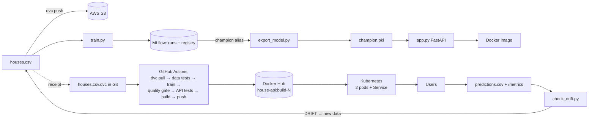

# House Price MLOps Project

An end-to-end MLOps project. A small house-price model goes through the full cycle: **versioned data (DVC + AWS S3) → tracked training (MLflow) → web API (FastAPI) → Docker → CI/CD with tests and a quality gate (GitHub Actions) → Kubernetes → monitoring and drift detection**.

It follows MLOps Labs 1–4. The labs give Windows/PowerShell commands; this README uses **macOS / Linux** commands.

| Topic | Lab | Files |
|---|---|---|
| Dataset, training, MAE | 1 | `houses.csv`, `train.py`, `predict.py` |
| MLflow tracking, registry, champion alias | 1, 2 | `train.py`, `export_model.py` |
| DVC + AWS S3 data versioning, time travel | 1, 2 | `houses.csv.dvc`, `.dvc/config`, `aws/dvc-bucket-policy.json` |
| FastAPI model API | 2, 4 | `app.py` |
| Docker | 2 | `Dockerfile`, `.dockerignore`, `requirements.txt` |
| Tests: data, quality gate, API, drift | 2, 4 | `tests/` |
| GitHub Actions CI/CD | 2 | `.github/workflows/ml-pipeline.yml` |
| Kubernetes (deploy, scale, rollback) | 3 | `k8s/deployment.yaml`, `k8s/service.yaml` |
| Monitoring (Prometheus) and drift (KS test) | 4 | `app.py` (`/metrics`), `prometheus.yml`, `send_traffic.py`, `check_drift.py` |

## Architecture



## Folder map

```
.github/workflows/ml-pipeline.yml   CI/CD pipeline
.dvc/config                         DVC settings (in Git, no secrets)
.dvc/config.local                   your AWS profile (NOT in Git)
aws/dvc-bucket-policy.json          IAM policy for the dvc-user
k8s/deployment.yaml, service.yaml   Kubernetes manifests
tests/                              test_data, test_model (quality gate), test_api, test_drift
houses.csv          data (NOT in Git, stored in S3)     houses.csv.dvc   receipt (in Git)
train.py  predict.py  export_model.py  app.py  send_traffic.py  check_drift.py
requirements.txt (API, pinned)      requirements-dev.txt (+ training/testing tools)
Dockerfile  .dockerignore  prometheus.yml  Makefile  pytest.ini
Re-created, NOT in Git: mlflow.db  mlruns/  model.pkl  champion.pkl  metrics.json  predictions.csv
```

---

## 0. Quick start (local, no AWS needed)

```bash
make setup               # creates .venv and installs everything (or: python3 -m venv .venv && .venv/bin/pip install -r requirements-dev.txt)
source .venv/bin/activate
make train-all           # trains linear, tree, forest -> MLflow versions v1, v2, v3
make promote             # alias 'champion' -> best version, saves champion.pkl
make train               # retrain linear so model.pkl/metrics.json are the gate's candidate
make test                # 19 tests pass
make api                 # http://127.0.0.1:8000/docs
```

`make help` lists every command. If port 8000 is busy (e.g. a PHP/Laravel server), use `make api PORT=8001`.

---

## 1. Training + MLflow (Lab 1)

```bash
python train.py            # linear  -> MAE 0.84
python train.py tree       # tree    -> MAE 4.83
python train.py forest     # forest  -> MAE 2.60
python predict.py          # price a 3-room, 1350 sqft house with model.pkl
python predict.py 5 2300   # any house
make mlflow-ui             # http://localhost:5000
```

In the dashboard: **Experiments → house-price-project**, then add the `mae` and `model_type` columns. Under **Model registry → house-price-model**, add the alias **`champion`** to the version with the lowest MAE. You can also do this from code:

```bash
python export_model.py --promote   # picks lowest MAE (newest on a tie), sets alias, writes champion.pkl
python export_model.py             # just exports whatever version has the alias
```

Each run logs the params `model_type`, `test_size` and `rows_in_dataset`, the metric `mae`, and the model, and registers it as a new version of `house-price-model`.

---

## 2. DVC + AWS S3 (Labs 1–2)

This repo is already connected: DVC remote `s3://hamza-mlops-dvc-2026/dvc` (us-east-1, profile `dvc` in `.dvc/config.local`), and the data has been pushed (md5 `cd37d1d7…`). The steps below show how it was set up, or how to point it at a different bucket.

### 2.1 AWS setup (once)
1. **S3 → Create bucket**, e.g. `yourname-mlops-dvc-2026`, region `us-east-1`. Keep *Block all public access* ON.
2. **IAM → Users → Create user** `dvc-user` (no console access) → *Attach policies directly* → *Create policy* → JSON: paste [aws/dvc-bucket-policy.json](aws/dvc-bucket-policy.json) with `YOUR-BUCKET` replaced in **both** places. Name it `dvc-bucket-access` and attach it.
3. `dvc-user` → *Security credentials* → *Create access key* (CLI) → download the .csv.
4. Configure and test:

```bash
aws configure --profile dvc                       # key id, secret, us-east-1, json
aws sts get-caller-identity --profile dvc         # Arn must end with user/dvc-user
aws s3 ls s3://YOUR-BUCKET --profile dvc          # no output = OK
aws s3 cp houses.csv s3://YOUR-BUCKET/test.csv --profile dvc && aws s3 rm s3://YOUR-BUCKET/test.csv --profile dvc
```

> ⚠️ Never paste the secret key into a chat, code or Git. If it leaks: IAM → dvc-user → Security credentials → Deactivate → Delete → create a new one.

### 2.2 Connect DVC and push the data

```bash
make dvc-remote BUCKET=YOUR-BUCKET REGION=us-east-1
cat .dvc/config          # url + region (safe for Git)
cat .dvc/config.local    # profile = dvc (never goes to Git)
git add . && git status  # houses.csv.dvc is listed; houses.csv and config.local are NOT
git commit -m "Track houses.csv with DVC, stored in S3"
python -m dvc push       # 1 file pushed
aws s3 ls s3://YOUR-BUCKET --recursive --profile dvc   # dvc/files/md5/cd/37d1d7cc...
```

The profile is saved with `--local` because the login is a personal setting. GitHub's runner uses its own keys from Secrets.

### 2.3 Time travel with data (Lab 2, Part B)

```bash
cat >> houses.csv <<'EOF'
2,900,55
3,1150,71
4,1900,113
5,2300,136
6,3400,195
EOF
python -m dvc status                  # houses.csv modified
python -m dvc add houses.csv          # new md5
python -m dvc push                    # data FIRST
git add houses.csv.dvc && git commit -m "November data: 35 houses"
python train.py                       # MLflow shows rows_in_dataset = 35

git log --oneline                                 # copy the OLDER commit id
git checkout <old-id> houses.csv.dvc && python -m dvc checkout && wc -l houses.csv   # 31 -> October is back
git checkout HEAD houses.csv.dvc && python -m dvc checkout && wc -l houses.csv       # 36 -> November is back
```

> **Rule:** always `dvc push` (data) **before** `git push` (receipt), or CI's `dvc pull` asks S3 for data that isn't there yet.

---

## 3. FastAPI model API (Labs 2 + 4)

```bash
python export_model.py                            # make sure champion.pkl exists
python -m uvicorn app:app --reload --port 8000    # or: make api
```

| Endpoint | Purpose |
|---|---|
| `GET /health` | `{"status":"ok"}`, used by Kubernetes probes |
| `POST /predict` | `{"rooms":3,"size_sqft":1350}` → `{"price_lakh":81.0}` |
| `GET /metrics` | Prometheus metrics (prediction count, latency, input sizes, predicted prices) |
| `GET /docs` | Interactive test page |

```bash
curl -X POST http://127.0.0.1:8000/predict -H 'Content-Type: application/json' -d '{"rooms":3,"size_sqft":1350}'
curl -X POST http://127.0.0.1:8000/predict -H 'Content-Type: application/json' -d '{"rooms":0,"size_sqft":1350}'   # 422
```

The model is loaded once at start-up. The input is validated by Pydantic (`rooms > 0`, `size_sqft > 0`). Every prediction is written to `predictions.csv`, the diary used for drift checks.

---

## 4. Docker (Lab 2, Part D)

```bash
make docker-build TAG=model-v1        # docker build -t house-api:model-v1 .
make docker-run TAG=model-v1          # docker run -d --name house-api -p 8000:8000 house-api:model-v1
curl http://127.0.0.1:8000/health
docker exec house-api python -c "import sklearn; print(sklearn.__version__)"   # 1.8.0, same as training
make docker-stop
```

The image contains only `app.py`, `champion.pkl` and pinned libraries. Data, MLflow records and training code stay out (see `.dockerignore`).

---

## 5. GitHub + CI/CD + tests (Lab 2, Part E)

### 5.1 The tests (`python -m pytest -v`)

| File | Kind | What it checks |
|---|---|---|
| `tests/test_data.py` | Data tests | correct columns, no empty cells, all values positive, ≥ 20 rows, whole-number rooms, size and price correlated |
| `tests/test_model.py` | **Quality gate** | `MAE < 3.0` (from `metrics.json`), bigger house → higher price |
| `tests/test_api.py` | API tests | `/health`, `/predict` returns a price, 422 on bad, zero or missing input, `/metrics`, diary row written |
| `tests/test_drift.py` | Drift tests | no drift for normal traffic, drift for luxury traffic, exit codes 1 / 0 |

### 5.2 Push to GitHub

```bash
git add . && git commit -m "House price MLOps project"
# create an empty PRIVATE repo 'house-price-mlops' on github.com (no README), then:
git remote add origin https://github.com/YOUR-NAME/house-price-mlops.git
python -m dvc push        # data first
git push -u origin main
```

### 5.3 Secrets (repo → Settings → Secrets and variables → Actions)

| Name | Value |
|---|---|
| `AWS_ACCESS_KEY_ID` | a **separate** access key for `dvc-user` (description: github-actions) |
| `AWS_SECRET_ACCESS_KEY` | its secret |
| `DOCKERHUB_USERNAME` | your Docker Hub username |
| `DOCKERHUB_TOKEN` | Docker Hub → Account settings → Personal access tokens (Read & Write) |

### 5.4 The pipeline (`.github/workflows/ml-pipeline.yml`)

```
push to main / PR / "Run workflow" button
  1. checkout + Python 3.13 + pip install -r requirements-dev.txt
  2. dvc pull (AWS keys from Secrets)
  3. data tests            -> bad data?   STOP
  4. drift detector tests
  5. python train.py
  6. quality gate          -> MAE ≥ 3?    STOP
  7. cp model.pkl champion.pkl
  8. API tests
  9. upload metrics.json as an artifact (always)
 10. build + push YOURNAME/house-api:build-N   (main only, not PRs)
```

Step 10 is skipped with a warning until the `DOCKERHUB_USERNAME` and `DOCKERHUB_TOKEN` secrets exist, so the pipeline can pass before Docker Hub is set up.

**Experiment 1 (gate blocks a bad model):** set `PASS_MARK = 0.1` in `tests/test_model.py` and push. The run turns red at the quality gate and no image is pushed. Set it back to `3.0` afterwards.
**Experiment 2 (continuous training):** add rows to `houses.csv`, then run `dvc add`, `dvc push`, `git add houses.csv.dvc`, `git commit` and `git push`. The pipeline retrains and pushes a new `build-N`.

---

## 6. Kubernetes (Lab 3)

Turn it on first: Docker Desktop → Settings → Kubernetes → **Enable Kubernetes** → Apply & restart. Make your Docker Hub repo `house-api` **Public**. Then replace `YOUR-DOCKERHUB-NAME` in `k8s/deployment.yaml`.

```bash
kubectl config use-context docker-desktop && kubectl config current-context   # MUST say docker-desktop
kubectl apply -f k8s/ && kubectl get pods -w                # 2 pods READY 1/1
curl http://localhost:8080/health                           # Service on port 8080
kubectl delete pod <pod-name> && kubectl get pods           # self-healing
kubectl scale deployment house-api --replicas=3             # scaling
# release: change image tag build-1 -> build-2 in deployment.yaml, then
kubectl apply -f k8s/ && kubectl rollout status deployment/house-api
kubectl rollout undo deployment/house-api                   # rollback in one command
kubectl set image deployment/house-api house-api=YOUR-DOCKERHUB-NAME/house-api:build-999   # broken release: old pods keep serving
kubectl rollout undo deployment/house-api
kubectl delete -f k8s/                                      # clean up
```

To get a second tag, use the **Run workflow** button in Actions → ML pipeline, or `docker tag` + `docker push` an existing build as `build-2`.

---

## 7. Monitoring + drift (Lab 4)

```bash
# window 1
make api                          # API with diary + /metrics (use PORT=8001 if 8000 is busy)
# window 2
make prometheus                   # http://localhost:9090 -> Status -> Target health: house-api UP
make traffic-normal && make drift # p-values ~0.9, "No drift", exit 0
make traffic-drift  && make drift # p-value 0.000, "DRIFT DETECTED", exit 1
echo $?
```

Prometheus query for the drift graph: `input_size_sqft_sum / input_size_sqft_count` (average house size requested). If you run the API on a port other than 8000, change the target in `prometheus.yml`.

**Close the loop.** Add the luxury houses that have now sold, retrain, and push:

```bash
cat >> houses.csv <<'EOF'
6,4200,250
7,4600,273
7,5000,295
7,5600,330
8,6200,364
8,7000,410
EOF
python train.py && python -m pytest       # MAE still under 3, all tests pass
python -m dvc add houses.csv && python -m dvc push
git add houses.csv.dvc && git commit -m "Add luxury house data" && git push   # CI retrains -> new build-N
make prometheus-stop
```

---

## Troubleshooting (macOS)

| Problem | Fix |
|---|---|
| `/predict` returns an HTML 404 page | Another app owns port 8000 (`lsof -nP -iTCP:8000 -sTCP:LISTEN`). Stop it or use `PORT=8001`. |
| `dvc` / `mlflow` not found | `source .venv/bin/activate`, or use `python -m dvc …` / `python -m mlflow …` |
| `export_model.py`: champion not found | Set the alias in MLflow, or run `python export_model.py --promote` |
| `FileNotFoundError: champion.pkl / metrics.json` in tests | Run `python train.py` and `python export_model.py` first |
| AWS `AccessDenied` | Check which user the error names; the policy must be attached and both `Resource` lines must have your bucket |
| CI red at `dvc pull` | Secret names exact? `profile` only in `.dvc/config.local`? Data pushed before the receipt? |
| CI red at Docker login | Wrong username, or the token isn't Read & Write |
| `ImagePullBackOff` | Docker Hub repo must be Public; check the username and tag in the YAML |
| `connection refused 127.0.0.1:6443` | Kubernetes isn't enabled in Docker Desktop |
| Prometheus target DOWN | The API must run with `--host 0.0.0.0` (as `make api` does) on the port in `prometheus.yml` |
